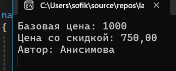
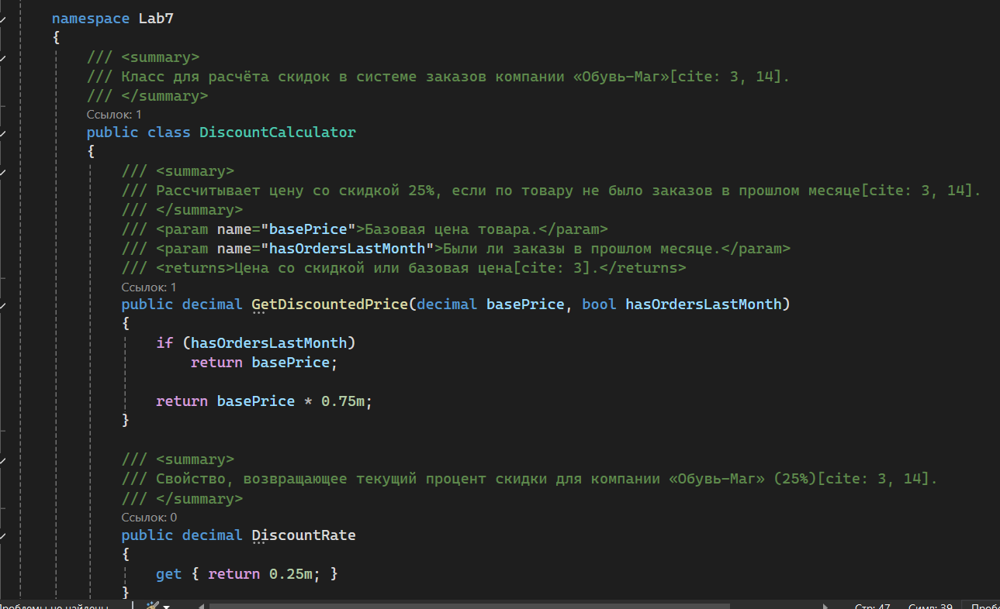
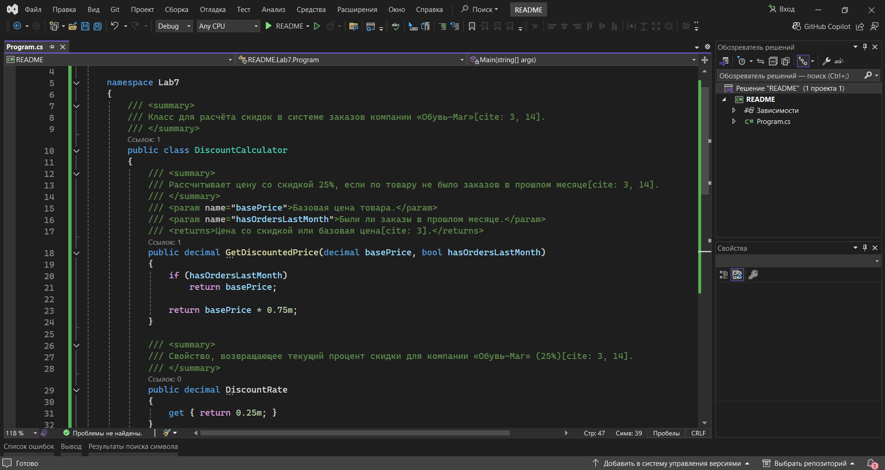

# Система заказов компании «Обувь-Маг»

**Автор:** Анисимова С.Р., группа И-42  
**Вариант:** № 1  

## Что делает программа
- Рассчитывает цену со скидкой 25% для товаров без заказов в прошлом месяце.
- Выводит базовую цену, цену со скидкой, а также информацию об авторе в консоль.
- Демонстрирует работу метода `GetDiscountedPrice` с использованием XML-комментариев.

## Как запустить
1. Открыть файл `src/README.sln` в SharpDevelop или Visual Studio.
2. Нажать клавишу `F5`.
3. В появившемся окне консоли отобразится результат расчёта.

## Скриншоты

### Скриншот 1: Результат работы программы

### Скриншот 2: XML-комментарии в коде

### Скриншот 3: Среда разработки
